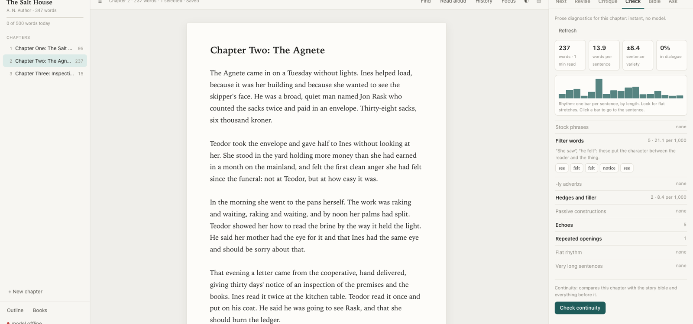

# Manuscript

A writing desk for book-length work that runs entirely on your own computer, with a local language model as your editor. You write; it reads what you wrote, helps you revise, and suggests what could come next. Nothing you write leaves your machine.



## What it does

You write your book chapter by chapter in a plain, quiet editor. A panel beside the page gives you an editor's tools:

- **Next** – three genuinely different directions for what to write next, each tied to what is already on the page. Or a rough 150-word draft in your voice to push off from.
- **Revise** – select a passage and ask for a line edit, a tightening, more concrete detail, better dialogue, a copyedit, or anything you type ("less sentimental"). The changes are shown marked up, with reasons. Nothing in your manuscript changes until you click Replace.
- **Critique** – an honest read of the chapter as a developmental editor, a line editor, a prize juror on a cold read, or a first-time reader.
- **Check** – instant prose diagnostics that need no model (sentence rhythm, filter words, adverbs, echoes, stock phrases, passive constructions), plus a continuity check against everything earlier in the book.
- **Bible** – a story bible of people, places and open threads. The editor can propose entries from the chapter you are in; you approve them.
- **Ask** – any question about your book ("has her age been consistent?").

Around that: find in the chapter or across the whole book, an outline of what the editor remembers of each chapter, version history for every chapter, a daily word goal, focus mode, read-aloud, and export to Markdown or to `.docx` in standard manuscript format.

The editor is instructed to protect your voice, quote your own lines back to you, and skip the flattery. It is a tool for a writer, not a ghostwriter.

### It does not read the whole book every time

Sending an entire manuscript to a local model on every request is slow and wasteful. Working in chapter 5, the model reads:

| | |
|---|---|
| Chapter 5 and chapter 4 | in full |
| Chapters 1–3 | a ~200-word summary each (one line each once they are more than six chapters back) |
| Story bible | only the entries the passage mentions |

It reaches further back only when there is a reason:

- A name on the page that has not appeared since an earlier chapter pulls in the passages where it was introduced and last seen. This is a plain text search and costs nothing.
- For **Ask** and **Check continuity**, the model is shown the summaries first and decides whether it needs to re-read an earlier chapter in full (two at most).

Summaries are written in the background shortly after you stop working on a chapter, and reused until that chapter changes. Under every answer, a "Read ≈N tokens" line lists exactly what was sent. The limits are the `BUDGET` numbers at the top of [`lib/context.js`](lib/context.js).

## What you need

- **Node.js 20.15 or newer** ([nodejs.org](https://nodejs.org)). There are no other dependencies and nothing to `npm install`.
- **A local model server that speaks the OpenAI chat API.** LM Studio, Ollama, llama.cpp's `llama-server`, vLLM and similar all work. A model with a large context window (32K tokens or more) and good prose judgement will serve you best.
- **macOS with Xcode's command-line tools**, only if you want the standalone Mac app. On any other system, or without Xcode, use it in a browser.

## Install

1. Get the code: download the latest release from the [Releases page](https://github.com/j01001100/manuscript/releases) and unzip it, or clone the repository:

   ```
   git clone https://github.com/j01001100/manuscript.git
   cd manuscript
   ```

2. Start your model server, if it is not already running.

3. Start Manuscript, either way:

   **In a browser (any system).** In the project folder:

   ```
   node server.js
   ```

   then open http://localhost:4747. On a Mac you can double-click `Start Manuscript.command` instead.

   **As a Mac app.** In the project folder:

   ```
   ./macos/build.sh --install
   ```

   This compiles a small native app, puts it in `/Applications`, and from then on you open **Manuscript** like any other app. It starts its own server when it opens and stops it when you quit. If you later move the project folder or reinstall Node, run that command again. (The first time, macOS may ask you to install Xcode's command-line tools; `xcode-select --install` does it.)

4. Tell it where your model is. Click the model name at the bottom left and enter your server's address and model name. Typical addresses:

   | Server | Address |
   |---|---|
   | LM Studio | `http://localhost:1234/v1` |
   | Ollama | `http://localhost:11434/v1` |
   | llama.cpp `llama-server` | `http://localhost:8080/v1` |

   The dot beside the model name turns green when Manuscript can reach it. Writing, find, diagnostics, history and export all work without a model; only the editor's tools need one.

5. Create your book. Only a title is needed. If you already have a draft, open the book's details (click its title) and choose **Import text**: lines like "Chapter 3" or "# Title" start a new chapter.

## Where your book lives

In the project folder, under `books/<your-book>/`, as plain files you can open without this app:

- `chapters/*.md` – the manuscript, one file per chapter
- `chapters/*.summary.json` – what the editor remembers of each chapter
- `bible.json` – people, places, open threads
- `snapshots/` – earlier versions: one every ten minutes while you write, one before every revision you accept, and one whenever most of a chapter is removed at once
- `trash/` – chapters you removed, with their earlier versions

Back up the `books` folder and you have backed up everything. Nothing is ever deleted by the app.

You can have the same chapter open in two windows. A window you return to picks up what the other saved; if both changed the chapter, the second to save is asked which version to keep, and the other goes into History.

## Privacy

The server listens only on `127.0.0.1` and refuses requests from other sites. Your text goes to the model server address you configured and nowhere else. If that address is a model running on your own machine, nothing leaves it.

## Working on the app

```
npm test
```

runs the tests with Node's built-in runner. They cover storage, the context engine, prose diagnostics, export, the model client and the server, and they never touch your books: each test file works in its own temporary folder.

Two environment variables are useful for trying things safely:

- `BOOKS_ROOT=/some/folder` keeps books there instead of `books/`
- `MANUSCRIPT_CONFIG=/some/file.json` uses that file instead of `config.json`

The layout:

- `server.js` – the HTTP server
- `lib/store.js` – files on disk; `lib/context.js` – what the model reads; `lib/prompts.js` – every instruction the editor is given; `lib/llm.js` – the model client; `lib/export.js` – Markdown and `.docx`
- `public/` – the interface (plain HTML, CSS and JavaScript, no build step)
- `macos/` – the native Mac wrapper and its build script

If you want the editor to hold a different standard, [`lib/prompts.js`](lib/prompts.js) is the place.

## Licence

MIT. See [LICENSE](LICENSE).
